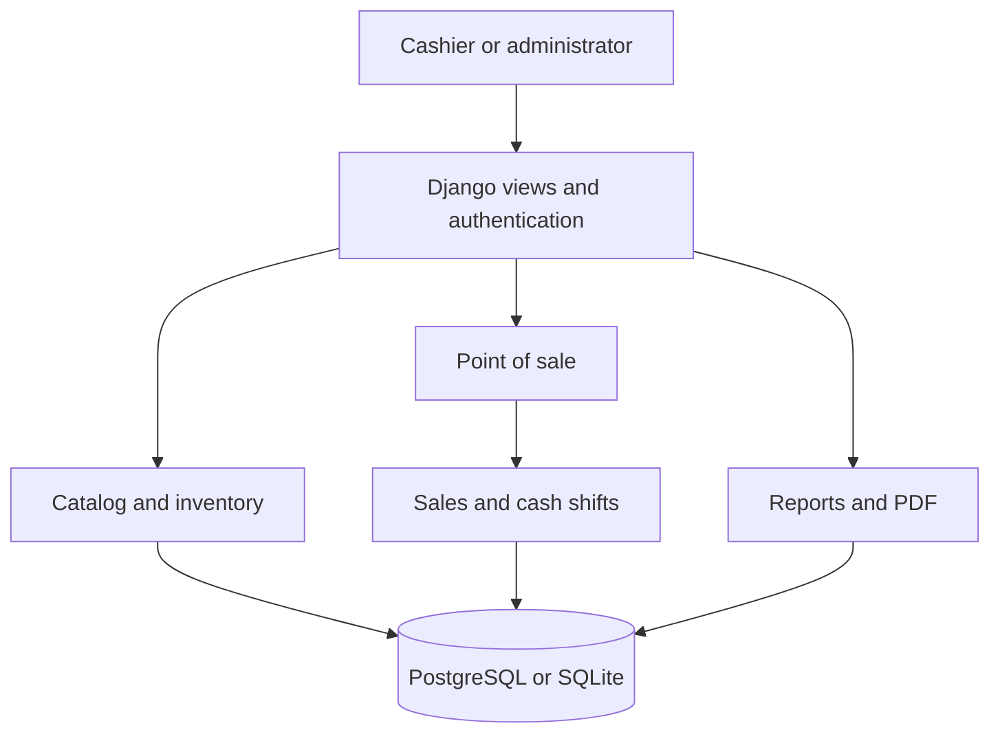

# Architecture

Caramelo POS is a Django application for retail operations.

The static Vercel demo is separate from the Django application and uses browser-local demo data.

## Deployment checklist

- Set POS_DEBUG=false and configure a strong POS_SECRET_KEY.
- Set POS_ALLOWED_HOSTS and database credentials explicitly.
- Configure HTTPS, secure cookies and reverse proxy settings as appropriate.
- Run Django system checks and review deployment warnings.
- Apply migrations and back up the database.
- Verify checkout, cancellation, purchasing and inventory transactions on PostgreSQL.
- Review concurrent sales, permissions and historical cost calculations.
- Review dependency audit results in CI.

SQLite CI checks are not a substitute for PostgreSQL concurrency tests.
